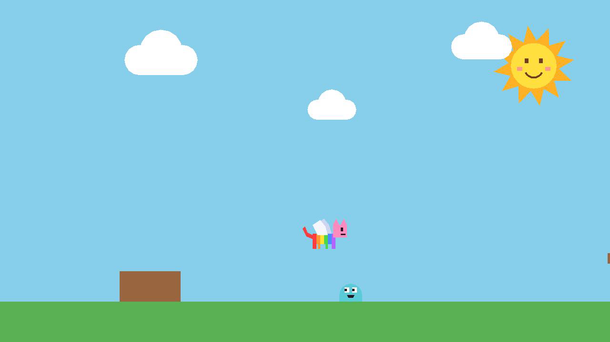

# rr-catgame-poc1

Um jogo 2D de plataforma com um gato, feito por pai e filha com a ajuda do
Claude. O jogo usa o motor Godot 4 e roda em Windows, Android e Mac.

Por enquanto, o gato tem corpo arco-íris, cabeça cor-de-rosa e asas. Ele
anda, pula e voa por duas fases e pula em cima dos monstrinhos.
Para rodar, use `godot --path .` na raiz do repositório. Ande com as setas ou
com A e D, e pule com a barra de espaço. Aperte o pulo de novo no ar para
voar. Um controle também funciona. Comece pelo [índice dos
documentos](docs/README.md).
